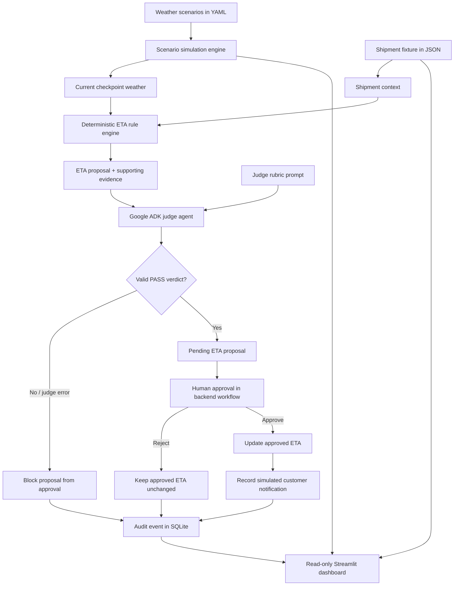
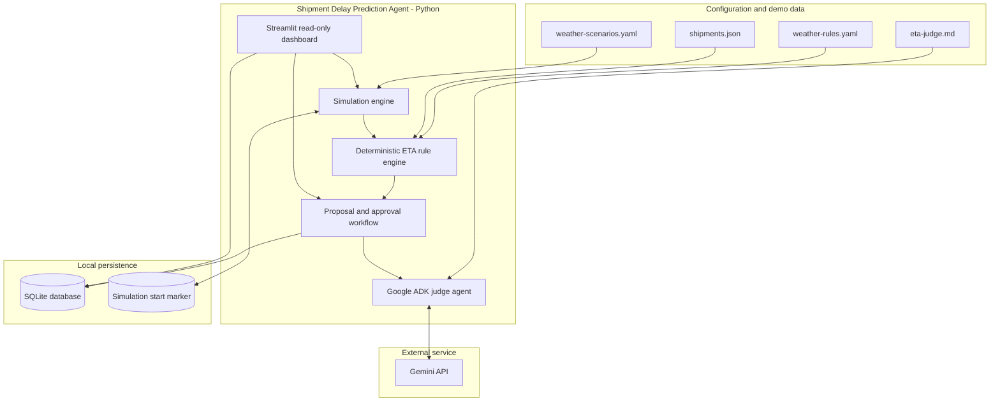
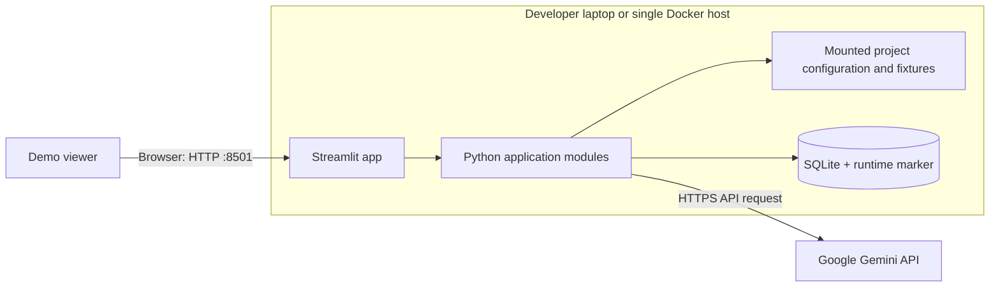

# Shipment Delay Prediction Agent

A deployable hackathon prototype that estimates shipment delays from weather conditions using **Python, Google ADK, Gemini as an LLM-as-a-Judge, Streamlit, YAML configuration, and SQLite**.

> **Demo only:** shipment and weather data are simulated. The delay rules are illustrative and are not calibrated logistics forecasts. The dashboard is read-only; it presents the current/predicted ETA and audit details. The backend retains its human-approval safeguard before an ETA is committed as approved or a simulated customer notification is recorded.

## Dashboard overview

The dashboard presents:
- Shipment summary, route, status, original ETA, and predicted ETA.
- Weather and delay impact at each route checkpoint.
- A plain-language ETA impact summary and current weather impact.
- Shipment details and audit history.

Internal scenario IDs, judge verdicts, approval controls, and the route timeline are not part of the read-only dashboard UI. Scenario progression and judge evaluation remain backend responsibilities.

## End-to-end flow

The following diagram shows the logical processing flow. The scenario engine advances the simulated weather automatically; the rule engine calculates the ETA proposal, while the LLM judge evaluates the evidence and reasoning rather than calculating the ETA itself.



## High-level design (HLD)

### Logical architecture



### Components

| Component | Responsibility |
|---|---|
| Streamlit dashboard | Read-only presentation of shipment, checkpoint weather, ETA impact, and audit history. |
| Simulation engine | Automatically advances through YAML-defined weather scenarios at the configured interval. |
| ETA rule engine | Calculates a proposed ETA from the shipment's remaining journey and applicable checkpoint weather. |
| Google ADK judge agent | Uses Gemini to assess evidence quality, rule compliance, ETA plausibility, and reasoning. It does not calculate the numerical ETA. |
| Proposal/approval workflow | Blocks proposals when the judge fails; preserves the approved ETA until the backend approval workflow approves a proposal. |
| SQLite | Stores shipment state, pending proposals, and audit events for the single-instance demo. |
| YAML/JSON/Markdown files | Keep scenarios, delay rules, sample shipment data, and judge instructions configurable. |
| Gemini API | External model endpoint used by the ADK judge; requires `GOOGLE_API_KEY`. |

### Infrastructure / deployment HLD

The current deployment is intentionally small and suitable for a hackathon demo:



**Local run:** Streamlit and all Python modules run in one Python process on the developer machine. SQLite and the simulation marker persist under `data/runtime/`.

**Docker run:** Docker Compose builds one container and exposes port `8501`. The `data/runtime/` directory is mounted as a volume so the SQLite database and simulation timer persist across container restarts. Set `GOOGLE_API_KEY` in `.env`; do not commit that file.

**Production evolution:** For a multi-user or multi-instance deployment, separate the dashboard from a background simulation/assessment worker, replace SQLite with a managed relational database, store secrets in a secret manager, add authentication/authorization and monitoring, and use a durable queue if assessment events must be processed reliably. Those production components are not included in this prototype.

## Requirements

- Python 3.11+
- Gemini API key for live judge evaluation (Google AI Studio key supported by the Google ADK Gemini integration)
- Docker is optional

## Run locally

```bash
git clone <your-repository-url>
cd shipment-delay-agent
python -m venv .venv
source .venv/bin/activate        # Windows: .venv\Scripts\activate
pip install -r requirements.txt
cp .env.example .env
# Add GOOGLE_API_KEY and confirm GEMINI_MODEL in .env
streamlit run dashboard/app.py
```

Open the local URL printed by Streamlit, usually `http://localhost:8501`. The app loads `.env` automatically. Never commit `.env`.

## Run with Docker

```bash
cp .env.example .env
# Set GOOGLE_API_KEY and GEMINI_MODEL in .env
docker compose up --build
```

Open `http://localhost:8501`.

## Demo behavior

1. Start the dashboard; the simulation starts from the configured scenario sequence.
2. Weather scenarios advance automatically according to `config/weather-scenarios.yaml`.
3. When a scenario changes, the app calculates a proposed ETA using deterministic rules.
4. The Google ADK judge evaluates the proposal. Judge errors, malformed responses, or non-passing verdicts fail closed.
5. The dashboard displays the current weather impact, predicted ETA, and audit events without exposing scenario IDs or judge verdicts.
6. The backend approval workflow remains the safeguard for committing an ETA update and recording a simulated customer notification.
7. When weather improves, ETA is recalculated from the remaining journey; the original ETA is not blindly restored.

## Configuration

- `config/weather-scenarios.yaml`: simulated checkpoint weather and scenario duration.
- `config/weather-rules.yaml`: illustrative delay adjustments by weather severity.
- `prompts/eta-judge.md`: judge rubric used by the ADK agent.
- `data/shipments.json`: simulated shipment fixture.
- `.env`: API key and model configuration; local-only and git-ignored.

## Safety and scope

- The rule engine, not the LLM, computes the numerical ETA proposal.
- A proposal must receive a valid judge `PASS` before it can proceed through the backend approval workflow.
- If the judge is unavailable, the proposal is blocked and an audit event is recorded.
- The dashboard is read-only; it does not expose approval/rejection controls.
- SQLite is appropriate for this single-instance prototype. For multi-instance deployment, use a managed database and a separate worker/scheduler.

## Tests

```bash
pytest -q
```

The tests cover deterministic ETA rules and basic approval safeguards. They do not call Gemini or validate a live browser session.
